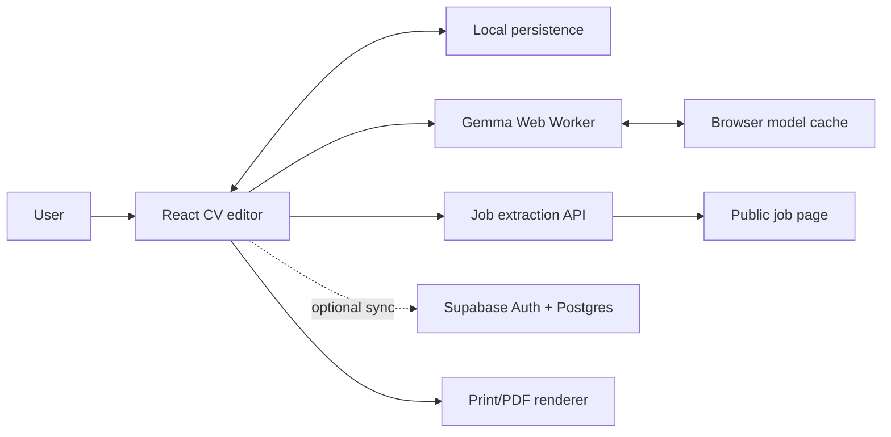

# Architecture

## System overview



## Trust boundaries

### Browser

The browser owns the canonical CV state, template rendering, local persistence, suggestion review, and Gemma inference. CV data must not be sent to the job extraction endpoint.

### Gemma worker

The worker owns model download, integrity-size checks, cache access, engine initialization, conversation lifecycle, streaming, cancellation, and structured generation. Worker messages use a typed protocol. The UI never accesses the inference engine directly.

Vite serves the worker as an ES module in development, but production must bundle and launch it as a classic worker because LiteRT's Emscripten WASM loader uses `importScripts()`. Do not force Vite's worker output format to `es`.

WebGPU initialization has a three-minute watchdog. Cancelling or timing out initialization terminates and recreates the worker because aborting the completed model fetch cannot interrupt `Engine.create()`. A verified cached model remains available for retry without another network download.

### Job extraction function

The function accepts one public HTTP(S) URL and returns normalized, size-limited job text plus basic metadata. It is not a general proxy. It must validate DNS/IP destinations before requests and redirects, allow only appropriate textual content, enforce timeout/size limits, and sanitize the document.

### Supabase

Supabase stores optional user-owned documents. The frontend uses a publishable key and relies on explicit grants plus RLS. Secret keys are not required for normal user CRUD.

## Frontend modules

```text
src/
├── app/                 routing and app shell
├── components/          shared accessible UI
├── cv/                  schema, state, commands, validation
├── editor/              field and section editors
├── templates/           pure CV renderers
├── ai/                  prompts, schemas, suggestion workflow
├── gemma/               worker, protocol, runtime facade
├── jobs/                URL/text ingestion and normalization
├── persistence/         local and Supabase repositories
├── print/               print preparation and pagination helpers
└── test/                fixtures and shared test utilities
```

## State model

- `CvDocument` is the only source of truth for resume content.
- The initial document is structurally valid but contains no personal or career facts. Fictional fixtures are test-only dependencies and never enter the production interface.
- Editor actions operate through typed commands.
- `AiAnalysis` is stored separately from `CvDocument`.
- `AiDesignRecommendation` is stored separately until the user accepts it; it can change only validated presentation settings.
- Accepting a suggestion creates a reversible patch and updates `CvDocument`.
- Template choice changes presentation only, never content.
- Local persistence is available immediately; cloud persistence is an optional adapter.

## Runtime flow

1. Load a valid local document or create a blank document.
2. Validate it against the CV schema.
3. Render the left-hand preview and right-hand Copilot controls from the same object.
4. Normalize pasted job text or retrieve it through `/api/extract-job`.
5. Build a bounded prompt containing the trusted instruction, CV facts, and untrusted job text in clearly delimited sections.
6. Ask Gemma for JSON matching `AI_PROTOCOL.md`.
7. Parse and validate the JSON; display errors without mutating the CV.
8. Apply only user-approved suggestion patches.
9. For design requests, validate Gemma output against the fixed template, density, and accent allowlists, display the rationale, and apply only after explicit acceptance.

## Deployment strategy

- Use Vercel for the Vite application and URL extraction function.
- Perform an early HTTPS smoke deployment to validate worker bundling, WASM resolution, Hugging Face CORS, Cache API behavior, and WebGPU.
- Connect Supabase only after the local editor and persistence interface work.
- Do not make deployment a prerequisite for local development.
