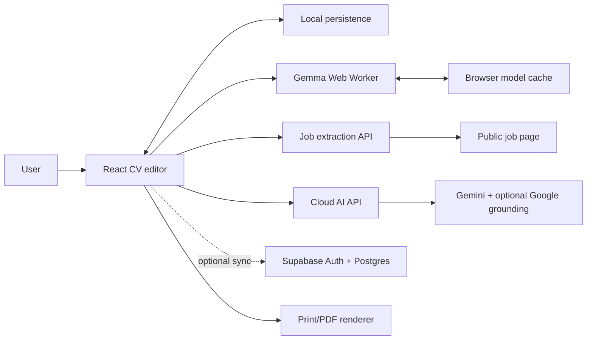

# Architecture

## System overview



## Trust boundaries

### Browser

The browser owns canonical CV state, template rendering, local persistence, suggestion review, direct preview editing, cloud consent, and optional Gemma inference. CV data must not be sent to job extraction or company research.

### Cloud AI function

The function accepts only fixed, schema-validated operations. Analysis and interview requests use compact CV facts after contact redaction; research accepts only public company, role, and job data. It owns the provider key, request timeouts, output ceilings, retries, rate limits, a daily budget, and an emergency switch. Outreach emails are generated deterministically in the browser and never consume provider quota.

### Gemma worker

The worker owns model download, integrity-size checks, cache access, engine initialization, conversation lifecycle, streaming, cancellation, and structured generation. Worker messages use a typed protocol. Every generation event carries a request ID, generation is serialized, and the UI ignores stale events. The UI never accesses the inference engine directly.

Vite serves the worker as an ES module in development, but production must bundle and launch it as a classic worker because LiteRT's Emscripten WASM loader uses `importScripts()`. Do not force Vite's worker output format to `es`.

WebGPU initialization has a three-minute watchdog. Cancelling or timing out initialization terminates and recreates the worker because aborting the completed model fetch cannot interrupt `Engine.create()`. A verified cached model remains available for retry without another network download.

Before a first download, the UI requires enough estimated browser storage for the verified model plus operational headroom. Cache writes may run alongside streamed loading, but the UI reports the cache as verified only after the model stream passes its byte check and engine creation succeeds. A failed new download is removed from cache.

Runtime sessions explicitly disable audio and vision modalities. Every text generation has a 90-second watchdog; timeout cancels the worker generation, retains partial output for local diagnosis, and retries only the failed compact stage.

The worker reports `queued`, conversation creation, conversation ready, and first-token/decode phases. The UI shows the phase, elapsed time, and local output character count without exposing CV text in logs.

### Job extraction function

The function accepts one public HTTP(S) URL and returns normalized, size-limited job text plus basic metadata. It is not a general proxy. It must validate DNS/IP destinations before requests and redirects, allow only appropriate textual content, enforce timeout/size limits, and sanitize the document.

### Supabase

Supabase Auth provides email/password signup, email confirmation, password recovery, persistent sessions, and sign-out. Postgres stores optional user-owned documents plus server-controlled account entitlements. The frontend uses a publishable key and relies on explicit grants plus RLS; premium write access is enforced in database policies rather than trusted to UI state. Secret keys are not required for normal user CRUD.

## Frontend modules

```text
src/
├── app/                 routing and app shell
├── components/          shared accessible UI
├── cv/                  schema, state, commands, validation
├── editor/              field and section editors
├── templates/           pure CV renderers
├── ai/                  prompts, schemas, suggestion workflow
├── gemma/               worker, protocol, runtime facade
├── jobs/                URL/text ingestion and normalization
├── persistence/         local and Supabase repositories
├── print/               print preparation and pagination helpers
└── test/                fixtures and shared test utilities
```

## State model

- `CvDocument` is the only source of truth for resume content.
- The initial document is structurally valid but contains no personal or career facts. Fictional fixtures are test-only dependencies and never enter the production interface.
- Tailor conversation messages are transient UI state. Job input feeds the normal typed analysis request; follow-up fit, gap, and edit explanations are derived from validated analysis state without sending chat history to a model.
- Editor actions operate through typed commands.
- Analysis, research, interview, and outreach results are stored separately from `CvDocument` and invalidated when their inputs change.
- `AiDesignRecommendation` is stored separately until the user accepts it; it can change only validated presentation settings.
- Accepting a suggestion creates a reversible patch and updates `CvDocument`.
- Template choice changes presentation only, never content.
- Local persistence is available immediately; cloud persistence is an optional adapter.
- Account navigation exposes `/account` and `/account/reset-password`; opening a cloud CV writes the validated canonical document into the normal local persistence path before returning to the editor.

## Runtime flow

1. Load a valid local document or create a blank document.
2. Validate it against the CV schema.
3. Render the left-hand preview and right-hand Copilot controls from the same object.
4. Normalize pasted job text or retrieve it through `/api/extract-job`.
5. For cloud analysis, obtain consent, redact contact fields, compact facts, and send a fixed operation to `/api/ai`; Private Mode uses the bounded worker protocol.
6. Parse and validate structured output, reject stale or ungrounded suggestions, and never substitute fictional production results on failure.
7. Apply only user-approved suggestion patches.
8. On explicit request, research company-and-role data with Google grounding and preserve claim-level citation mappings.
9. Reconstruct interview pitches deterministically from cited CV IDs and generate outreach templates locally.
10. Direct preview edits use a closed field-target union and the normal undo/persistence path.

## Deployment strategy

- Use Vercel for the Vite application and URL extraction function.
- Perform an early HTTPS smoke deployment to validate worker bundling, WASM resolution, Hugging Face CORS, Cache API behavior, and WebGPU.
- Connect Supabase only after the local editor and persistence interface work.
- Do not make deployment a prerequisite for local development.
