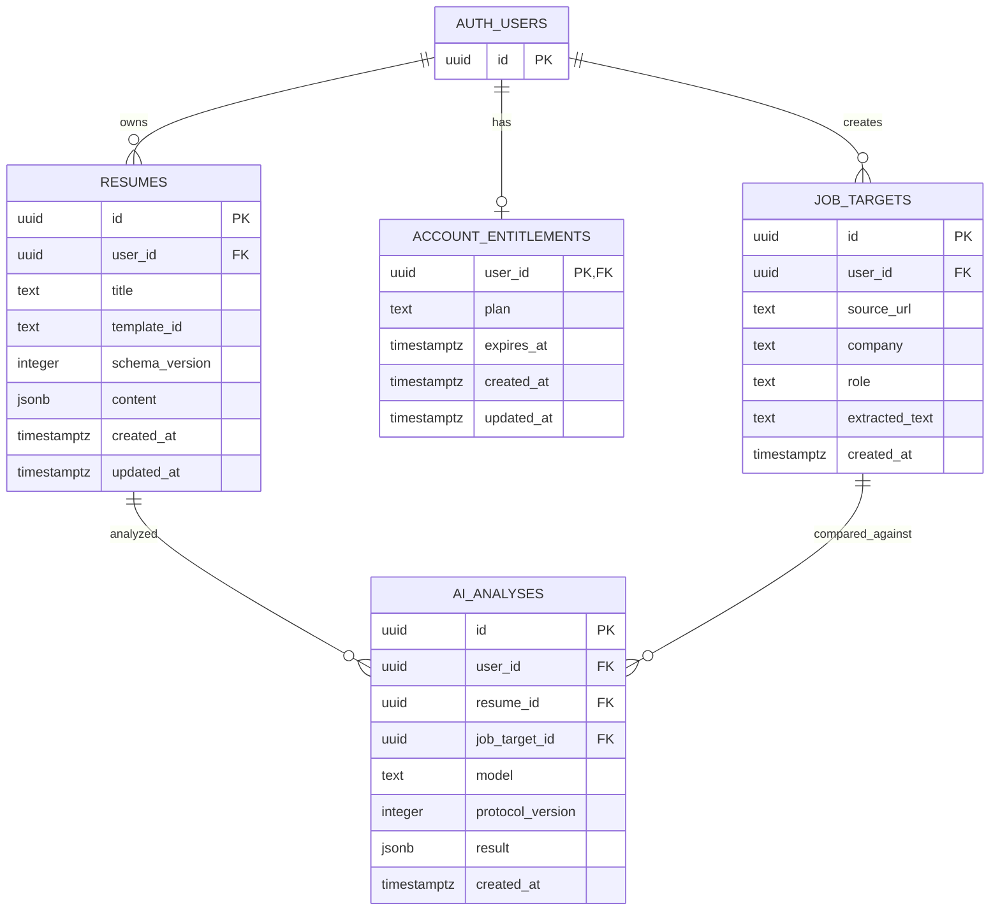

# Persistence ERD

The MVP stores each CV as a versioned JSON document. Templates remain in source code and are not database records.

## Table rules

### `account_entitlements`

- A missing row means free access; `premium` with no expiry or a future expiry enables cloud document writes.
- Browser clients may read only their own entitlement and cannot insert, update, or delete entitlement rows.
- Entitlements are administered outside the product for the MVP; payment and checkout flows remain excluded.

### `resumes`

- `content` must validate as the current `CvDocument` before write.
- `schema_version` enables future document migrations.
- `template_id` is presentation preference, not part of CV facts.
- All CRUD is owner-only.

### `job_targets`

- Persisting a job target is optional.
- Store sanitized extracted text, not full page HTML.
- All CRUD is owner-only.

### `ai_analyses`

- Stores the validated structured result for reproducibility.
- `model` records the precise runtime model identifier.
- An analysis must belong to the same user as its resume and job target.
- Deleting a resume or job target should delete dependent analyses.

## Access model

- Browser access uses the `authenticated` role.
- Every table has RLS enabled.
- SELECT, INSERT, UPDATE, and DELETE policies verify ownership.
- UPDATE policies use ownership predicates in both `USING` and `WITH CHECK`.
- Resume INSERT and UPDATE additionally require an active premium entitlement; owner SELECT and DELETE remain available so an expired plan never traps user data.
- Explicit grants expose only required operations to `authenticated`.
- `anon` receives no table access for the MVP.

## Deferred entities

Resume versions, stored PDF binaries, public share links, custom templates, subscriptions, teams, and comments are intentionally excluded.
